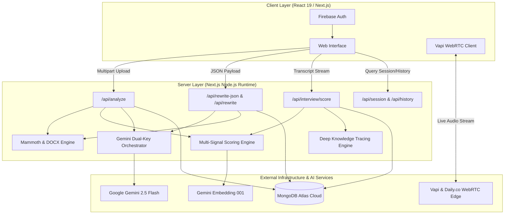

# JobConnect

JobConnect is an enterprise-grade career preparation and candidate optimization platform centered around **real-time conversational voice mock interviews**. Powered by low-latency WebRTC streaming and dynamic voice intelligence, JobConnect conducts live, human-like verbal technical interviews that dynamically adapt to a candidate's resume gaps and target job descriptions. The platform pairs sub-second interactive voice interrogation—graded against the STAR framework and tracked across attempts using Deep Knowledge Tracing (DKT)—with multi-signal lexical and semantic resume analytics and generative resume optimization built on Google's XYZ formula.

---

## Problem Statement & Architecture Philosophy

Modern recruitment pipelines present two systemic challenges for job candidates:
1. **The Screening Bottleneck**: Over 75% of qualified applicants are filtered out by Applicant Tracking Systems (ATS) due to phrasing discrepancies, missing domain keywords, or poor structural formatting, despite possessing relevant competency.
2. **The Preparation Gap**: Candidates rarely receive objective, technical interview preparation tailored specifically to the blind spots and weaknesses exposed by their resume relative to the targeted job description.

JobConnect resolves this through a closed-loop system:
- **Analyze**: Ingest candidate documents and cross-reference them against job descriptions via multi-signal lexical and semantic scoring.
- **Optimize**: Reconstruct resume achievements according to Google's XYZ formula ("Accomplished [X] as measured by [Y], by doing [Z]") to maximize ATS pass rates.
- **Simulate**: Conduct lifelike, low-latency conversational voice interviews targeting detected skill gaps.
- **Trace**: Model candidate mastery progression across interview retakes using Deep Knowledge Tracing (DKT).

---

## System Architecture

---

## Core Capabilities

### 1. Multi-Signal Scoring Pipeline
Rather than relying on single-pass heuristic matching or isolated LLM prompting, JobConnect computes candidate alignment through a four-stage scoring matrix:

- **Lexical Frequency (TF-IDF)**: Built with `natural`, evaluating Term Frequency-Inverse Document Frequency across candidate text and employer requirements to quantify exact domain vocabulary matches.
- **Semantic Vector Similarity**: Generates dense mathematical vector representations via `gemini-embedding-001` and evaluates cosine similarity to identify contextual alignment even where vocabulary differs (e.g., matching "PostgreSQL" to "relational databases").
- **ATS Structural Simulation**: A deterministic algorithmic audit evaluating heading conventions, contact metadata presence, quantifiable metric density, and bullet point structure.
- **Hybrid Fusion Engine**: Blends deterministic lexical scores, semantic vector distances, and LLM contextual assessments with dynamic confidence calibration.

### 2. Resume Surgeon with Google's XYZ Methodology
JobConnect features a real-time resume optimization workspace designed around the standard established by Google's People Operations:

> **Google XYZ Formula**: Accomplished **[X]**, as measured by **[Y]**, by doing **[Z]**.

The optimization engine:
- Takes raw, unquantified bullets (e.g., *"Helped optimize web application performance."*)
- Identifies missing technical requirements from the target job description.
- Restructures them into high-impact, metric-driven statements (e.g., *"Accelerated end-to-end page render latency by 42% [Y] by re-architecting client-side state caching with React and Redis [Z], supporting 120,000 daily active users [X]."*).
- Re-evaluates the rewritten text in real time against the ATS scoring engine, displaying verified before-and-after score deltas.
- Compiles the final data into a clean, ATS-compliant `.docx` document server-side via `docx`.

### 3. Voice Mock Interviews with Deep Knowledge Tracing (DKT)
- **Sub-Second Voice Interaction**: Integrates `@vapi-ai/web` and Daily.co WebRTC to deliver real-time, bidirectional voice dialogue. The interviewer speaks and listens with human-level cadence, latency, and tone.
- **Dynamic Context Injection**: The voice agent is dynamically configured with the candidate's exact identified weaknesses, asking pointed technical and scenario-based questions tailored specifically to their missing competencies.
- **STAR Rubric Evaluation**: Post-interview analysis grades responses across Situation, Task, Action, and Result dimensions, paired with technical depth assessments and filler word frequency metrics.
- **Deep Knowledge Tracing Engine**: Implements an algorithmic knowledge tracing model that maps skill acquisition across successive interview attempts. It models candidate state transitions, identifies persistent cognitive gaps, and produces an overarching Readiness Index.

### 4. Direct Cloud Persistence & Dashboard Analytics
- All user profiles, gap analyses, rewrite caches, transcript logs, and scorecard progression are persisted directly to **MongoDB Atlas**.
- The dashboard visualizes attempt progression over time, longitudinal skill mastery, and allows selective deletion of past evaluation sessions.

---

## Technology Stack

| Layer | Technologies | Purpose |
| :--- | :--- | :--- |
| **Frontend Architecture** | Next.js 16 (App Router), React 19, Tailwind CSS | High-performance reactive UI, server-side streaming, and component rendering. |
| **Backend API** | Node.js Runtime, Next.js Route Handlers | Serverless REST API endpoints for document processing, scoring, and data persistence. |
| **Database Tier** | MongoDB Atlas, Mongoose ODM | Cloud document storage with compound indexing (`userId` + `createdAt`) and schema validation. |
| **Artificial Intelligence** | Google Gemini 2.5 Flash, Gemini Embedding 001 | Resume gap analysis, Google XYZ achievement restructuring, and embedding generation. |
| **Voice & Audio WebRTC** | Vapi Web SDK (`@vapi-ai/web`), Daily.co | Ultra-low-latency real-time voice synthesis and speech-to-text processing. |
| **Document Processing** | `mammoth`, `docx` | Server-side parsing of DOCX files into raw text buffers and programmatic generation of styled DOCX files. |
| **NLP & Text Processing** | `natural` | Lexical tokenization, TF-IDF corpus analysis, and vocabulary frequency scoring. |
| **Authentication** | Firebase Authentication | Secure Google OAuth client-side lifecycle and user token management. |

---

## API Reference

### Analysis & Processing
- `POST /api/analyze`: Multipart form upload containing `file` (DOCX), `jobDescription`, and optional `uid`. Returns full gap analysis, lexical metrics, and generated `analysisId`.
- `POST /api/rewrite-json`: Accepts resume text, target job description, and gap data. Returns Google XYZ optimized resume JSON with re-evaluated ATS metrics.
- `POST /api/rewrite`: Same as `/api/rewrite-json`, returning a formatted `.docx` binary stream.

### Interview Evaluation
- `POST /api/interview/score`: Accepts `analysisId`, `uid`, and full conversation `messages`. Computes STAR rubric scores, communication confidence metrics, keyword coverage, and updates the candidate's DKT state.

### Data Management
- `GET /api/session?id={analysisId}&uid={uid}`: Retrieves analysis data and past scorecards.
- `DELETE /api/session?id={analysisId}&uid={uid}`: Deletes an analysis record from MongoDB.
- `GET /api/history?uid={uid}`: Retrieves all past sessions for a user, sorted chronologically.
